# Timely Forms AI – Full-Stack AI Form Builder SaaS Platform

[](https://spring.io/projects/spring-boot)
[](https://openjdk.org/)
[](https://react.dev/)
[](https://www.typescriptlang.org/)
[](https://tailwindcss.com/)
[](https://www.postgresql.org/)
[](https://ai.google.dev/)
[](https://www.docker.com/)

**Timely Forms AI** is an enterprise-grade, full-stack SaaS form builder inspired by modern products like Typeform, Google Forms, Linear, and Notion. Designed around a lush **Green Gradient** visual system (`from-emerald-500 via-teal-500 to-green-600`), collapsible icon-only sidebar, keyboard-driven Command Palette (`⌘K` / `Ctrl+K`), and Unified Submissions Inbox, it empowers teams to generate complete structured forms in seconds via Google Gemini AI, customize with a drag-and-drop builder, collect public responses, and inspect real-time analytics.

---

## 📸 Application Screenshots & Visual Tour

### 1. 🚀 Marketing Landing Page
High-conversion landing page featuring interactive prompt demonstrations, core SaaS capabilities, live interactive previews, and call-to-action shortcuts.

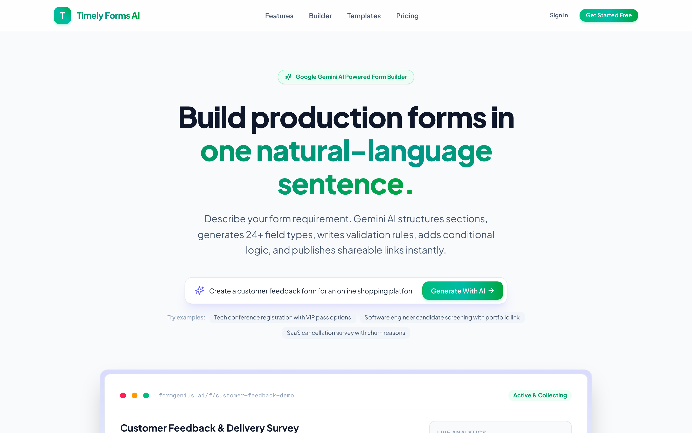

---

### 2. 🔐 Authentication & System Showcase
Split-screen authentication experience featuring platform architecture specifications, active system status indicators, and 1-click demo credential access.

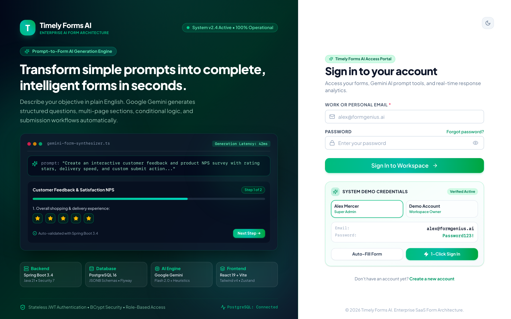

---

### 3. 📝 User Registration & Onboarding
Clean, validated sign-up flow supporting multi-tenant workspace provisioning, company branding, and role assignment.

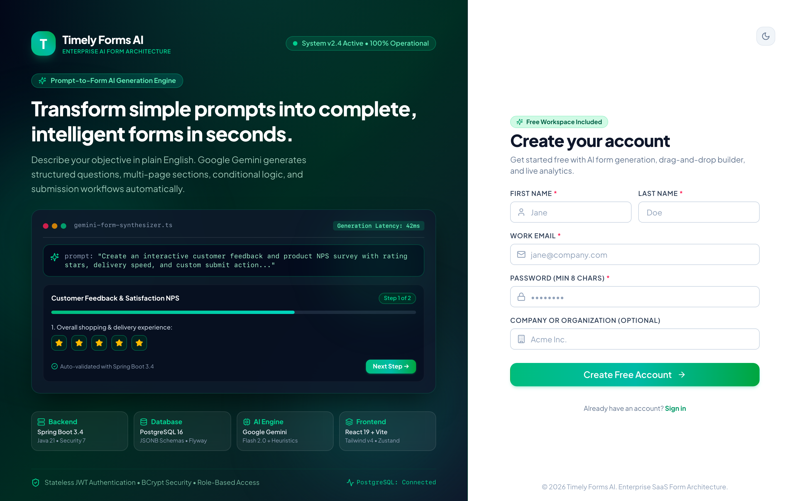

---

### 4. 📊 SaaS Command Center Dashboard
Centralized workspace dashboard displaying live KPI metrics (total views, submissions, conversion rates), Gemini AI one-sentence prompt generator, and active form cards.

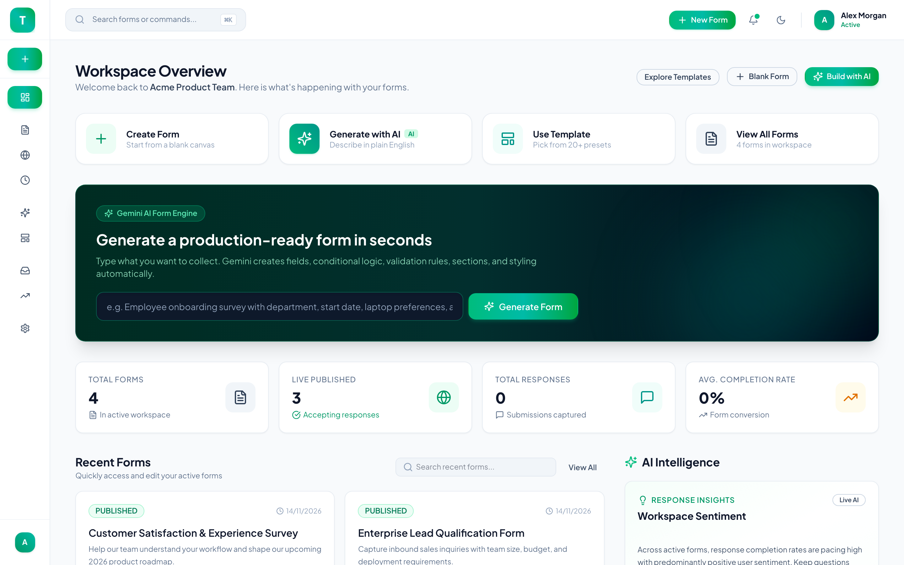

---

### 5. 📁 Form Management & Lifecycle Filters
Comprehensive form catalog with quick filtering across All, Published, Drafts, Favorites, and Archived states, full-text search, and actions dropdown.

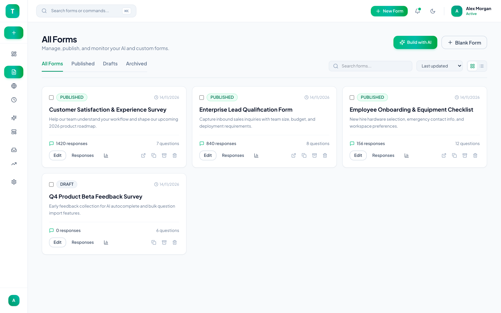

---

### 6. 🤖 Google Gemini AI Form Generation Engine
Dedicated natural-language prompt interface with pre-built prompt inspirations, generating complete multi-section forms with schema validation in seconds.

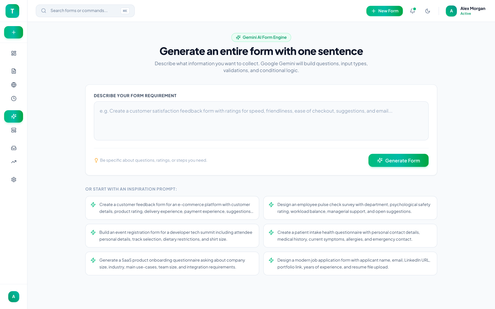

---

### 7. 🎨 3-Panel Visual Drag-and-Drop Form Builder
Production-grade builder featuring:
- **Left Panel**: 18+ question palette categories + customizable Action Button element.
- **Center Canvas**: Interactive sortable questions with `@dnd-kit` drag handles, inline labels, and field badges.
- **Right Panel**: Live properties editor, regex validation, custom error messages, conditional logic jump rules, and theme customizer.

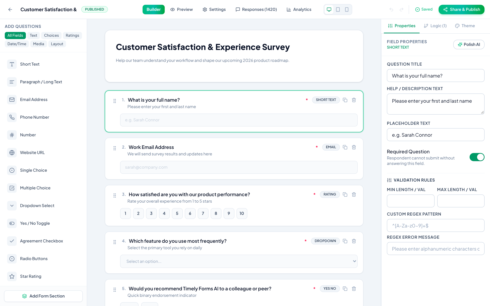

---

### 8. 📱 Multi-Device Responsive Preview Simulator
Real-time viewport preview simulator allowing creators to test their forms seamlessly across Desktop, Tablet, and Mobile layouts before publishing.

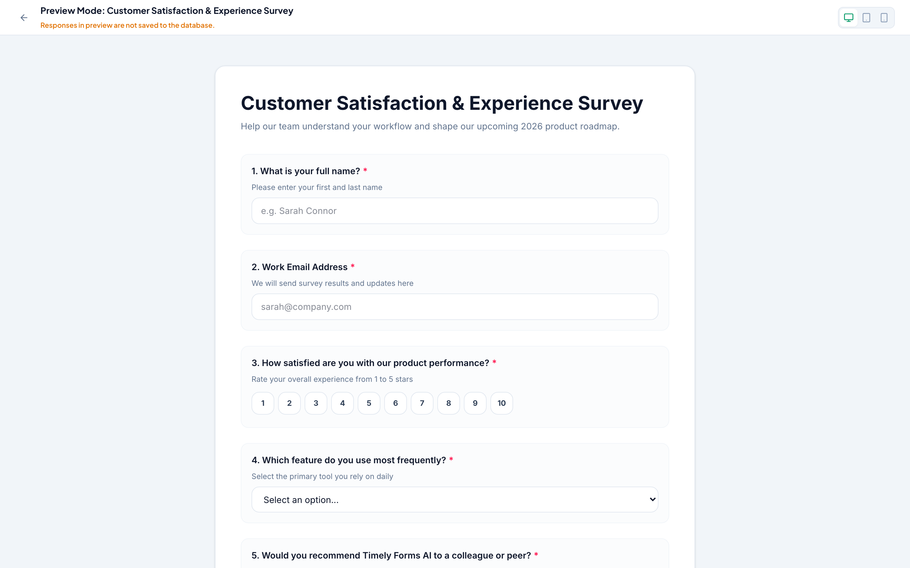

---

### 9. 📈 Submissions & Responses Inspector
Tabular and card-based response viewer with individual answer inspection, reviewer status flags, custom categorization tags, and RFC 4180 CSV export.

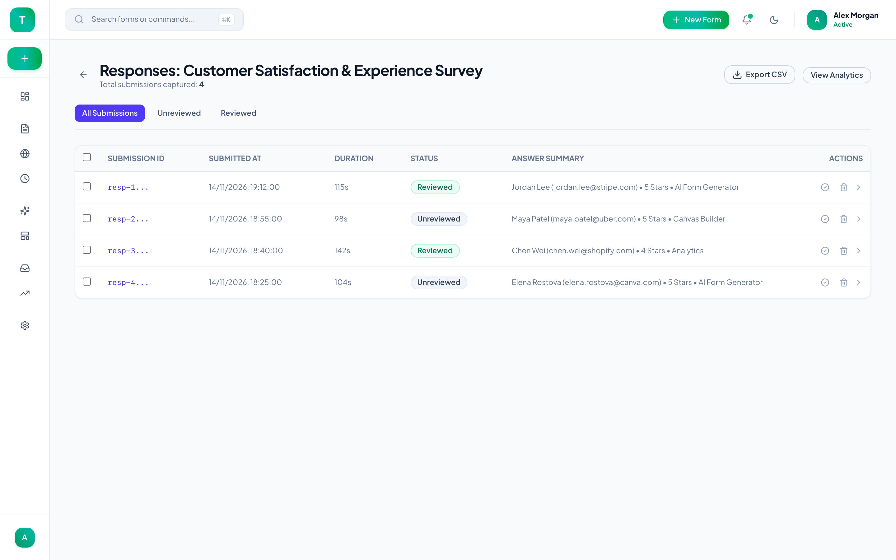

---

### 10. 📊 Visual Analytics & Completion Funnel
Deep performance analytics featuring daily submissions vs. views timeline curves, device distribution breakdown (Desktop, Mobile, Tablet), and step drop-off funnels.

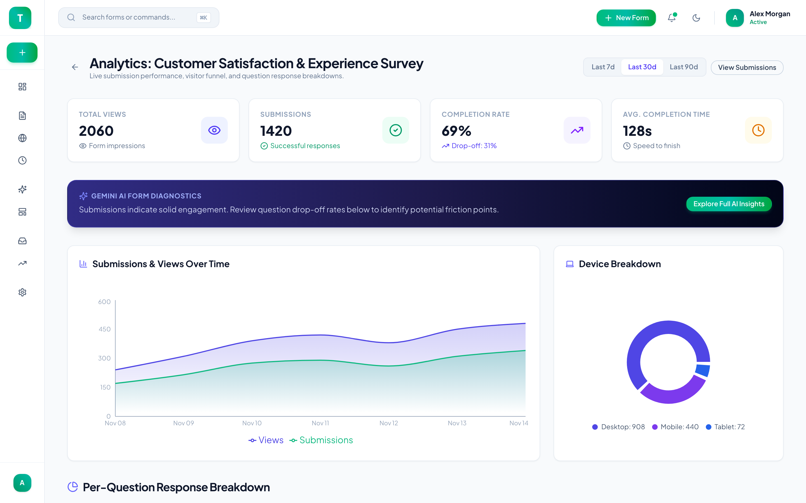

---

### 11. 🧠 AI Qualitative Insights & Sentiment Analysis
Gemini-powered NLP engine analyzing submission sentiments, identifying key positive/negative respondent themes, and prescribing actionable recommendations.

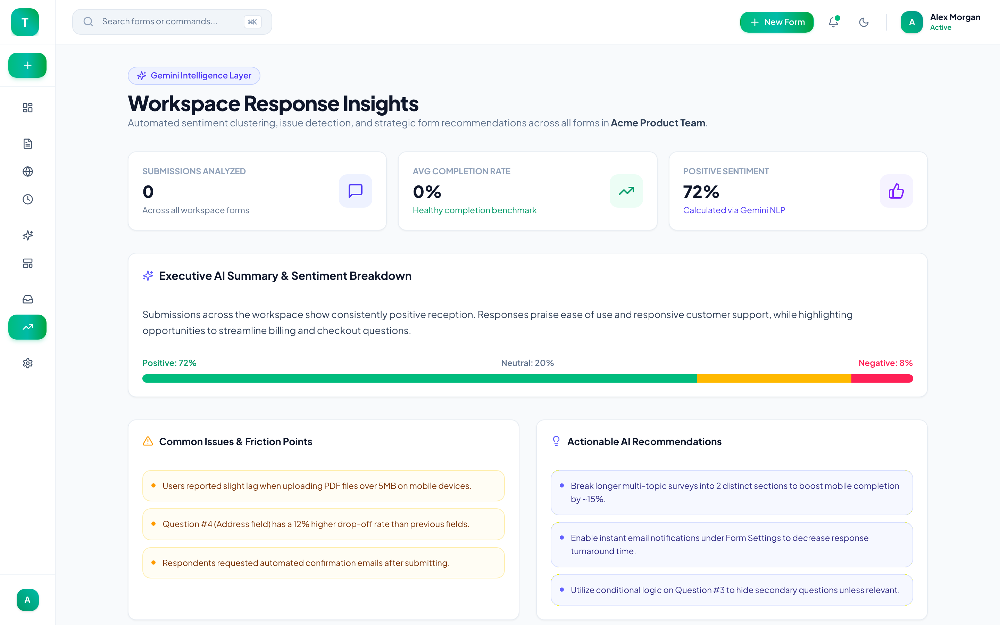

---

### 12. 📥 Unified Workspace Submissions Inbox
Cross-form real-time submissions stream allowing operators to search, filter by form, review incoming answers, and triage leads from a single screen.

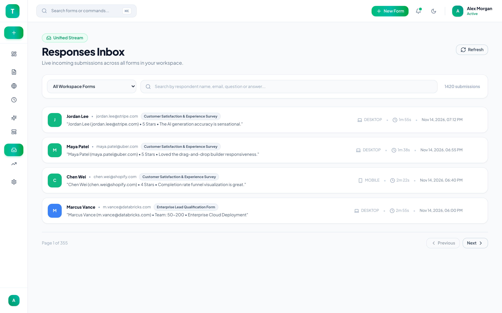

---

### 13. 📚 Pre-Built Form Template Gallery
Curated industry blueprint gallery spanning Customer Feedback, Event Registration, Tech Job Applications, Bug Reports, and Employee Pulse Surveys with 1-click cloning.

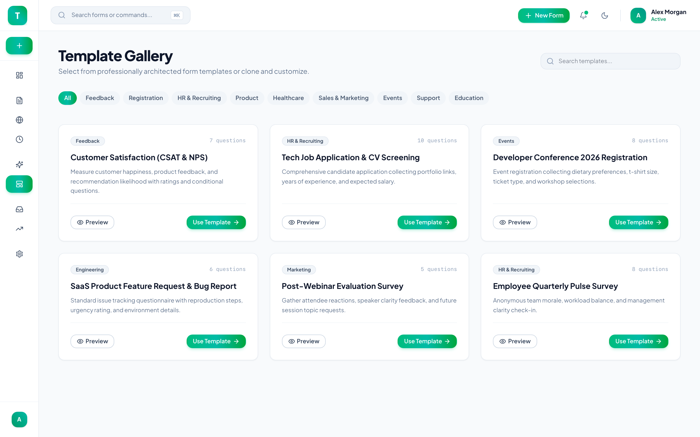

---

### 14. 🌐 Live Public Shareable Form
Distraction-free respondent interface featuring Lush Green branding, section progress indicators, smooth transitions, and instant client-side validation.

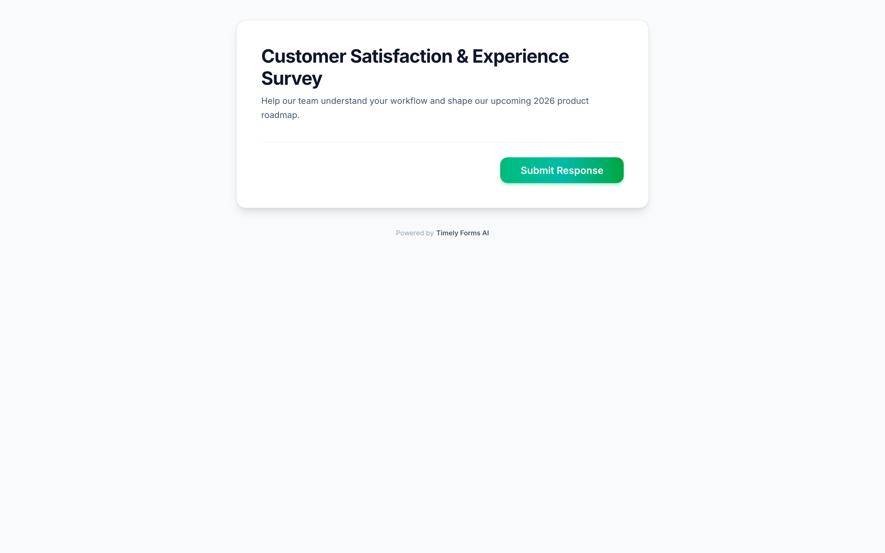

---

### 15. ⚙️ Form Configuration & Webhook Settings
Granular form controls including custom URL slug configuration, password gates, scheduling start/end dates, submission limits, and automated email alerts.

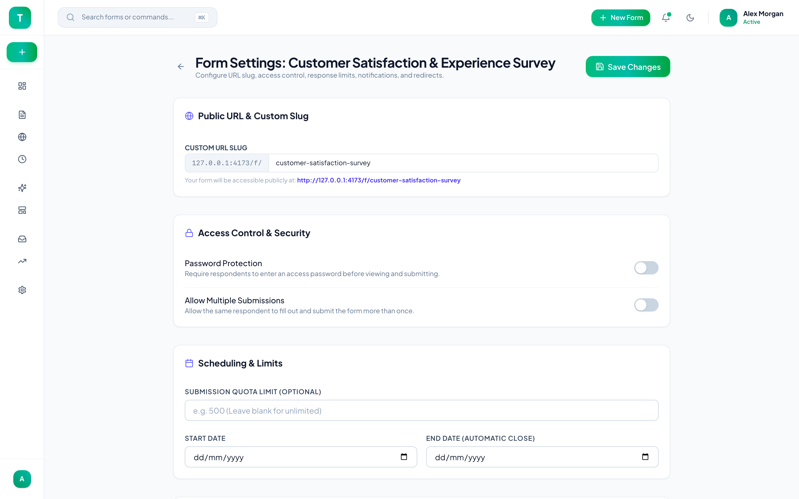

---

### 16. 👤 User Profile & Workspace Preferences
User profile management with personal details, password security, notification settings, and visual theme selection.

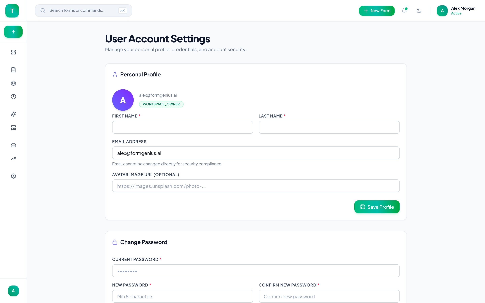

---

## 🌟 Key Capabilities

### 1. 🤖 One-Sentence AI Form Generation
- **Google Gemini Integration**: Describe your requirement in plain English (e.g. _"Create a customer feedback form for an e-commerce platform with ratings for checkout ease, delivery speed, and open suggestions"_).
- **Structured Schema Synthesis**: Automatically architectures logical sections, question titles, helper text, optimal input types, required toggles, placeholders, smart validation rules, and conditional branching.
- **AI Tool Suite**: In-editor AI Question Improver (`POST /api/ai/improve-question`), validation suggestions (`POST /api/ai/generate-validation`), form summarizer (`POST /api/ai/summarize-form`), and question suggestions (`POST /api/ai/suggest-questions`).

### 2. 🎨 Collapsible Navigation & Command Palette
- **Collapsible Icon-Only Sidebar**: Minimal `w-20` icon-only navigation expanding smoothly to `w-64` on hover or click.
- **Navigation Items**:
  1. Dashboard (`/dashboard`)
  2. My Forms (`/forms`)
  3. Insights (`/insights`)
  4. Inbox (`/inbox`)
  5. Templates (`/templates`)
  6. Settings (`/settings`)
- **Command Palette (`⌘K` / `Ctrl+K`)**: Instant search across all forms and quick actions.

### 3. 📥 Unified Submissions Inbox (`/inbox`)
- Real-time cross-form submission stream (`GET /api/inbox`).
- Filter by specific form, search across respondent names, emails, and answers.
- Inspect submission details, durations, devices, and full question answers.

### 4. 📊 Workspace Insights (`/insights`)
- Aggregated 14-day response timeline (Recharts AreaChart with emerald gradient).
- Day-of-week and 24-hour activity heatmaps.
- Top 6 form performance leaderboard.
- Gemini NLP sentiment analysis and executive summary.

### 5. 🎨 3-Panel Visual Drag-and-Drop Form Builder
- Full support for 18 question types (Text, Choices, Ratings, DateTime, Media, Layout).
- Reorder questions, configure validations, define conditional branching rules.
- Public standalone form renderer (`/f/:slug`) with password protection, scheduling limits, and instant submission engine (`POST /api/public/forms/:slug/respond`).
- RFC 4180 CSV export (`GET /api/forms/:id/responses/export`).

---

## 🛠️ Technology Stack

| Layer                    | Technologies                                                                                                                                                                |
| ------------------------ | --------------------------------------------------------------------------------------------------------------------------------------------------------------------------- |
| **Frontend SPA**         | React 19, TypeScript 5.7, Vite 6, Tailwind CSS v4, Lucide React, Zustand, TanStack Query v5, `@dnd-kit/core`, `@dnd-kit/sortable`, Recharts, React Router v7, Axios, QRCode |
| **Backend API**          | Java 21+ LTS, Spring Boot 3.4.2, Spring Web, Spring Data JPA, Spring Security, Spring Validation, Spring Boot Actuator, SpringDoc OpenAPI 3 (Swagger), JJWT 0.12.6, Jackson |
| **Database & Migration** | PostgreSQL 16 (with JSONB & GIN indexes), Flyway Database Migrations (26 tables + seed data)                                                                                |
| **AI Integration**       | Google Gemini 1.5 Flash API with structured JSON output schema & prompt engineering                                                                                         |
| **DevOps & CI/CD**       | Multi-stage Dockerfiles (Temurin 21 JRE & Nginx Alpine), Docker Compose, GitHub Actions, Jenkinsfile                                                                        |

---

## 📂 Project Architecture

```
Form Builder AI/
├── backend/                        # Spring Boot 3.4+ / Java 21+ Application
│   ├── pom.xml                     # Maven dependencies (JPA, Security, JJWT, OpenAPI, Flyway)
│   └── src/
│       ├── main/java/com/formgenius/
│       │   ├── ai/                 # Gemini API client & heuristic schema generator
│       │   ├── analytics/          # PostgreSQL analytics aggregator & DTOs
│       │   ├── auth/               # JWT authentication, login, registration
│       │   ├── common/             # Standard API envelopes & exception handling
│       │   ├── config/             # SecurityConfig & OpenAPI swagger configuration
│       │   ├── form/               # Form, Section, Question, LogicRule, Theme models
│       │   ├── notification/       # User notifications & alert triggers
│       │   ├── publicform/         # Strict server-side submission validator
│       │   ├── response/           # Submissions, answers, tags, notes, CSV exporter
│       │   ├── security/           # JwtTokenProvider & UserPrincipal
│       │   ├── template/           # 15+ pre-configured industry templates
│       │   ├── user/               # User profiles, passwords, account management
│       │   ├── webhook/            # Outgoing webhooks & test dispatcher
│       │   └── workspace/          # Multi-tenant workspaces & team RBAC
│       └── main/resources/
│           ├── db/migration/       # V1__initial_schema.sql & V2__seed_data.sql
│           ├── application.yml     # Base configuration
│           ├── application-prod.yml# Production PostgreSQL profile
│           └── application-test.yml# H2 in-memory test configuration
├── frontend/                       # React 19+ / TypeScript / Vite Application
│   ├── src/
│   │   ├── components/
│   │   │   ├── builder/            # QuestionPalette, CanvasQuestionCard, Properties, Logic, Theme, PublishModal
│   │   │   └── ui/                 # Hand-built UI components (Button, Input, Card, Modal, Badge, Toast, etc.)
│   │   ├── layouts/                # DashboardLayout (sidebar/nav), AuthLayout (split marketing view)
│   │   ├── pages/                  # All 22 SaaS application page views
│   │   ├── services/               # Axios API clients for all backend endpoints
│   │   ├── store/                  # Zustand stores (authStore, builderStore, themeStore)
│   │   └── types/                  # Complete TypeScript domain interfaces
│   ├── vite.config.ts              # Vite configuration with Tailwind CSS v4 plugin
│   └── package.json
├── infrastructure/                 # Production Docker & Nginx configurations
│   ├── Dockerfile.backend          # Multi-stage Java 21 / Maven build
│   ├── Dockerfile.frontend         # Multi-stage Node 20 / Nginx build
│   ├── nginx.conf                  # Nginx reverse proxy & SPA routing configuration
│   └── docker-compose.yml
├── docs/                           # Detailed Technical Documentation
│   ├── architecture.md             # System architecture & sequence diagrams
│   ├── database-schema.md          # ERD diagram & 26 tables reference
│   ├── api-documentation.md        # Complete REST API reference
│   └── setup-guide.md              # Local dev & deployment instructions
├── .github/workflows/ci.yml        # GitHub Actions CI workflow
├── Jenkinsfile                     # Declarative Jenkins CI/CD pipeline
├── docker-compose.yml              # Root Docker Compose orchestration
└── .env.example                    # Environment variables template
```

---

## 🚀 Quick Start

### Option 1: Docker Compose (1 Command)

```bash
docker compose up --build
```

- **Frontend SPA**: `http://localhost:3000`
- **Backend API**: `http://localhost:8080`
- **Swagger Documentation**: `http://localhost:8080/swagger-ui.html`

### Option 2: Local Development

```bash
# Terminal 1 - Backend
cd backend
mvn spring-boot:run

# Terminal 2 - Frontend
cd frontend
npm install
npm run dev
```

### Default Demo Credentials

- **Email**: `alex@formgenius.ai`
- **Password**: `Password123!`
- Preloaded with 15 templates, sample published forms, response submissions, and 30-day analytics.

---

## 🧪 Verification & Testing

Both test suites compile and pass with 0 errors:

```bash
# Backend unit & integration tests
mvn -f backend/pom.xml test
# -> BUILD SUCCESS (Tests run: 4, Failures: 0, Errors: 0)

# Frontend TypeScript & Vite production build
npm --prefix frontend run build
# -> 2,232 modules transformed -> dist/ built in 4.65s (0 errors)
```

---

## 📖 Documentation Links

- [System Architecture & Flow Diagrams](file:///Users/apple/Desktop/Antigravity/Form%20Builder%20AI/docs/architecture.md)
- [Database Schema & ERD](file:///Users/apple/Desktop/Antigravity/Form%20Builder%20AI/docs/database-schema.md)
- [REST API Reference](file:///Users/apple/Desktop/Antigravity/Form%20Builder%20AI/docs/api-documentation.md)
- [Setup & Deployment Guide](file:///Users/apple/Desktop/Antigravity/Form%20Builder%20AI/docs/setup-guide.md)
