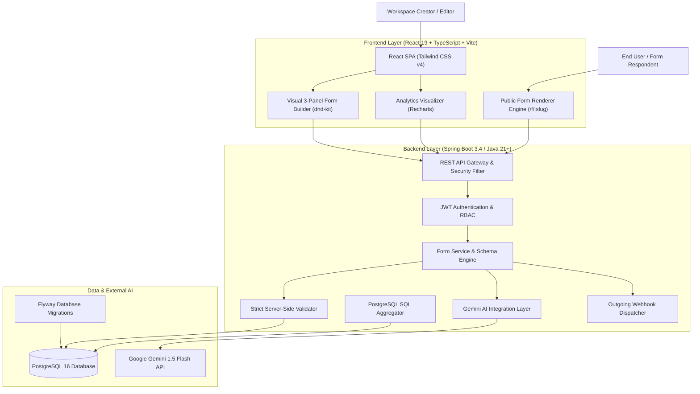
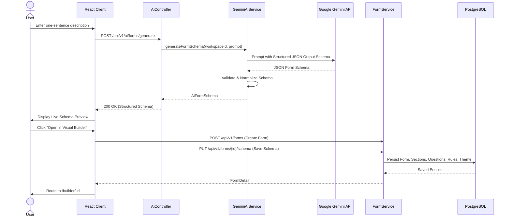
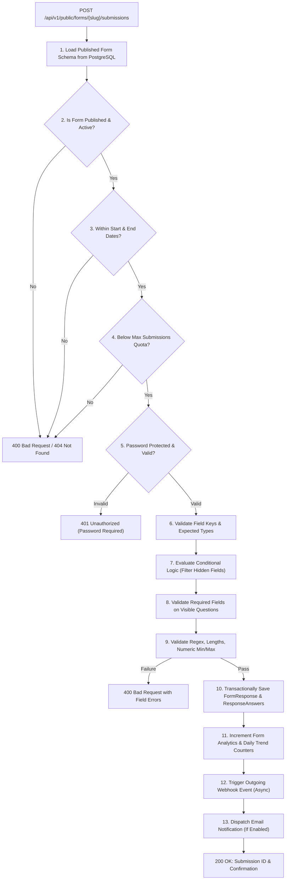

# FormGenius AI – Architecture Documentation

## 1. System Overview

**FormGenius AI** is an enterprise-ready, full-stack AI-powered SaaS form builder platform. It enables users to describe any form requirement in natural language and instantly receive a fully structured, multi-section form schema complete with appropriate input types, conditional branching, validation rules, and themes.

---

## 2. Frontend Architecture (React 19 + TypeScript)

The frontend is structured around clear separation of concerns:
- **`src/pages/`**: 22 dedicated page views covering public marketing, authentication, workspace dashboard, AI generator, 3-panel visual form builder, live form preview, form settings, public submissions (`/f/:slug`), submission success, responses spreadsheet, response detail, analytics, AI insights, template gallery, team RBAC, notifications, profile, workspace settings, and billing.
- **`src/components/builder/`**:
  - `QuestionPalette.tsx`: Draggable component palette with 24 question types grouped into Text, Choice, Rating, DateTime, Media, and Layout categories.
  - `CanvasQuestionCard.tsx`: Sortable question item with dnd-kit integration, inline editing, and live dummy field preview.
  - `PropertiesEditor.tsx`: Right panel property editor with AI question improver, choice options manager, and validation constraints.
  - `LogicEditor.tsx`: Conditional branching engine (IF question X equals Y THEN show/hide question Z).
  - `ThemeEditor.tsx`: Styling engine (brand accent colors, background, typography, border radius, header banner, logo).
  - `PublishModal.tsx`: Sharing modal with public link copy, QR code generator, and iFrame embed snippet.
- **`src/store/`**:
  - `authStore.ts`: Global authentication state, JWT tokens, active workspace, user profile.
  - `builderStore.ts`: Form builder state, history snapshot undo/redo stack, selected question/section, auto-save status.
  - `themeStore.ts`: Dark/light mode theme toggle.
- **`src/services/`**:
  - Axios HTTP client with JWT request interceptor and automatic 401 token refresh.
  - Dedicated service modules for auth, forms, public submissions, responses, analytics, AI, templates, members, notifications, and webhooks.

---

## 3. Backend Architecture (Spring Boot 3.4 / Java 21+)

The backend follows an idiomatic, modular layered design:
1. **Controller Layer**: REST endpoints documented with OpenAPI 3 (Swagger).
2. **Security & Filter Layer**:
   - `JwtAuthenticationFilter`: Parses and verifies `Bearer` tokens on incoming requests.
   - `SecurityConfig`: Stateless session management, BCrypt password hashing, and role-based route authorizations.
3. **Service Layer**:
   - `FormService`: CRUD operations on forms, sections, questions, and themes. Schema versioning and form duplication.
   - `PublicFormService`: Strict server-side validation pipeline verifying field identifiers, question types, required fields, conditional rules, regex patterns, and numeric ranges.
   - `GeminiAiService`: Integration with Google Gemini API using structured JSON output, prompt engineering, schema normalization, and offline heuristic fallbacks.
   - `AnalyticsService`: High-performance PostgreSQL SQL aggregations for daily submission trends, completion rates, and per-question distributions.
   - `WebhookService`: Asynchronous webhook delivery to external URLs on form events.
4. **Data Access Layer**: Spring Data JPA repositories with custom JPQL and native PostgreSQL queries.

---

## 4. AI Form Generation Flow

---

## 5. Public Form Submission & Validation Pipeline

Security is critical: the application enforces **real server-side validation** for every submission. Frontend validation provides smooth UX, but the backend validates all constraints before database persistence:

