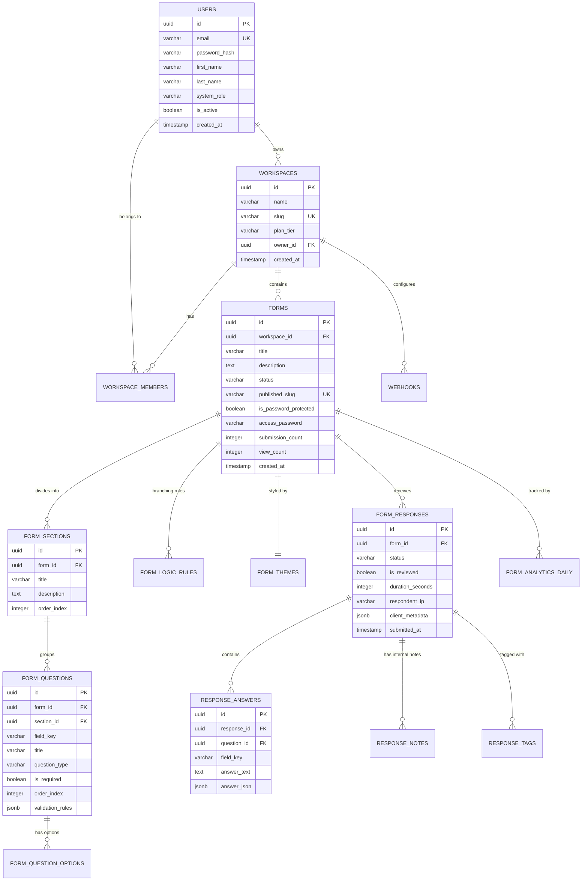

# FormGenius AI – Database Schema Documentation

## 1. Overview & Migration Architecture

Database migrations are managed via **Flyway**:
- `V1__initial_schema.sql`: Complete relational schema containing 26 tables, foreign key constraints, indexes, and JSONB fields.
- `V2__seed_data.sql`: Production-grade seed data containing default admin user (`alex@formgenius.ai`), initial workspace (`acme-workspace`), 15 prebuilt form templates across diverse industries, sample published forms, response submissions, tags, internal notes, and 30-day analytics history.

---

## 2. Entity-Relationship Diagram

---

## 3. Database Tables Reference

### Core Identity & Workspaces
1. **`users`**: User authentication credentials, system roles (`SUPER_ADMIN`, `WORKSPACE_OWNER`, `ADMIN`, `EDITOR`, `VIEWER`), email verification, and profile timestamps.
2. **`user_profiles`**: Extended user preferences, timezone, avatar URL, job title, and phone number.
3. **`workspaces`**: Multi-tenant workspace entities, custom slug, quota limits (max forms, max responses per month, AI generation credits).
4. **`workspace_members`**: Membership join table linking users to workspaces with workspace-scoped roles.
5. **`workspace_invitations`**: Pending invitation tokens sent to teammates with role assignment and expiration dates.

### Forms & Visual Builder
6. **`forms`**: Core form entities with metadata, status (`DRAFT`, `PUBLISHED`, `ARCHIVED`), unique URL slug, password protection, and submission limits.
7. **`form_sections`**: Logical multi-page or single-page groupings with titles and display order.
8. **`form_questions`**: Comprehensive question entity supporting all 24 input types, field keys, required toggles, placeholders, and JSONB validation constraints.
9. **`form_question_options`**: Options for choice, dropdown, and radio fields with labels, values, and order indices.
10. **`form_logic_rules`**: Conditional branching rules (source question, operator, condition value, action, target question).
11. **`form_themes`**: Aesthetic configurations including primary accent color, background color, font family, border radius, header banner, and logo URL.
12. **`form_publications`**: Historical log of publish and unpublish events with custom slugs and timestamps.

### Submissions & Response Management
13. **`form_responses`**: Master record of each form submission including duration, completion status, review flag, client IP, and browser metadata.
14. **`response_answers`**: Individual answers mapped to questions and field keys with plain text or JSON values.
15. **`response_notes`**: Internal team discussion notes on individual submissions.
16. **`response_tags`**: Tag assignments for organizing responses (e.g. VIP, Needs Review, Bug).
17. **`response_files`**: Uploaded file attachments with storage paths, file names, sizes, and MIME types.

### Analytics & AI Insights
18. **`form_analytics_daily`**: Aggregated daily impressions, submissions, completions, and abandonment rates.
19. **`question_analytics_cache`**: Pre-aggregated frequency distributions and numeric averages for questions.
20. **`ai_workspace_insights`**: Persisted Gemini AI analysis snapshots including sentiment scores, complaint clusters, and recommendations.

### Templates, Notifications & Webhooks
21. **`form_templates`**: Pre-built form templates across 15+ industry categories with ready-to-clone schemas.
22. **`notifications`**: User alerts for new responses, team invites, and quota events.
23. **`webhooks`**: Outgoing webhook endpoints with secret HMAC keys and subscribed events.
24. **`webhook_deliveries`**: Log of dispatched webhook payloads, response HTTP codes, and retry counts.

---

## 4. Indexing & Optimization

- **B-Tree Indexes**:
  - `idx_forms_workspace_id`: High-performance workspace form filtering.
  - `idx_forms_published_slug`: Sub-millisecond lookup for public forms by URL slug.
  - `idx_questions_form_id`, `idx_sections_form_id`: Fast retrieval of complete form schemas.
  - `idx_responses_form_id`, `idx_responses_submitted_at`: Rapid spreadsheet pagination and time-series sorting.
  - `idx_answers_response_id`: Instant loading of full submission answers.
- **GIN Indexes on JSONB**:
  - `validation_rules` on `form_questions` for arbitrary rule evaluation.
  - `client_metadata` on `form_responses` for device and browser analytics.
